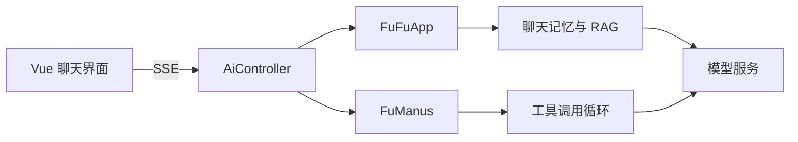

# CM AI Agent

**Spring Boot + Vue 的智能体应用实验，探索流式对话、RAG 与工具调用。**

[后端入口](src/main/java/com/dali/fuaiagent/) · [Vue 前端](fu-ai-agent-frontend/) · [API 控制器](src/main/java/com/dali/fuaiagent/controller/AiController.java)

## 项目简介
CM AI Agent 是一个基于 Spring Boot 3 的多智能体应用示例，整合 Spring AI、DashScope、LangChain4j 等能力，提供向量检索问答、工具编排与流式对话能力，同时配套了一个基于 Vue 3 + Vite 的前端界面。后端提供健康检查和面向聊天场景的 SSE 接口，前端通过事件流渲染实时响应，适合用于构建中文场景下的智能助手。

## 功能特性
- **聊天与工具编排**：`/ai/fufu_app` 系列接口支持同步或 SSE 流式响应，并可在对话中调用注册的工具；`/ai/manus/chat` 暴露多步骤执行的超级智能体，能够在需要时串联多个工具完成任务。
- **知识增强 (RAG)**：`FuFuApp` 通过文件式聊天记忆、查询改写与向量检索增强模型回答能力，默认会将 `classpath*:document/*.md` 下的 Markdown 文档加载进 SimpleVectorStore。
- **外部工具与 MCP 扩展**：系统注册了文件操作、网页搜索/抓取、资源下载、终端命令、PDF 生成及终止器等工具，可供代理按需调用；其中终端工具默认使用 `cmd.exe`，在 Linux/Mac 上需要自行调整实现。
- **多步骤智能体**：`FuManus` 继承自通用的 ReAct/ToolCall Agent 基类，拥有更详细的系统提示、步骤上限与 SSE 推送实现，适合处理复杂任务流。
- **前端体验**：前端应用提供 FUFU 聊天界面，使用 SSE 持续接收分片消息并展示连接状态；API 基址由 `VITE_API_BASE_URL` 配置，未设置时使用同源 `/api`；Axios 与 SSE 共用该配置。
- **基础运维能力**：提供 `/health` 健康检查方便探活与监控。

## 请求如何流动



## 代码阅读入口

| 关注点 | 入口 |
| --- | --- |
| 流式接口与请求分派 | [AiController](src/main/java/com/dali/fuaiagent/controller/AiController.java) |
| 对话记忆与检索增强 | [FuFuApp](src/main/java/com/dali/fuaiagent/app/FuFuApp.java) |
| 多步骤代理 | [FuManus](src/main/java/com/dali/fuaiagent/agent/FuManus.java) |
| 工具注册 | [ToolRegistration](src/main/java/com/dali/fuaiagent/tool/ToolRegistration.java) |
| 前端 API 与 SSE | [API 模块](fu-ai-agent-frontend/src/api/index.js) |

## 目录结构
- `src/main/java/com/dali/fuaiagent`：后端核心代码（控制器、智能体、RAG、工具等）。
- `src/main/resources/document`：示例知识库 Markdown 文档，启动时会被载入向量库。
- `fu-ai-agent-frontend/`：Vue 3 + Vite 前端工程及静态资源。
- `chat-memory/`：运行时自动创建的本地对话记忆目录，采用 Kryo 序列化存储会话数据。

## 环境要求
- Java 21 及 Maven；仓库也提供 `mvnw`/`mvnw.cmd`，首次运行需要下载 Maven。
- Node.js（建议 18+）与 npm，用于运行前端脚本和 Vite 开发服务器。
- 可用的 DashScope API Key，并在 Spring AI 中配置对应的 `ChatModel` Bean（代码通过 `dashscopeChatModel` 注入）。
- SearchAPI 的 `search-api.api-key`，供网页搜索工具使用。
- PostgreSQL + pgvector：当前 `PgVectorVectorStoreConfig` 无条件注册向量存储 Bean，启动完整后端需要相应数据源与扩展，或先自行调整该配置。

## 配置指南
1. 在 `application.yml` 或环境变量中配置 Spring AI 所需的 DashScope 参数，例如：
   ```yaml
   spring:
     ai:
       dashscope:
         api-key: ${DASHSCOPE_API_KEY}
   ```
   并配置数据库 `spring.datasource.*`，满足当前 `PgVectorVectorStoreConfig` 的启动依赖。
2. 设置网页搜索工具所需的 API Key：
   ```yaml
   search-api:
     api-key: ${SEARCH_API_KEY}
   ```
3. 如需扩展知识库，将新的 Markdown 文档放入 `src/main/resources/document`，应用重启后会自动读取并写入向量库。
4. 若后端部署在自定义域名/端口，请设置前端 `VITE_API_BASE_URL`，使其指向正确的 API 基址（包含后端 context path）。
5. 在非 Windows 环境下使用终端工具时，请将 `cmd.exe` 调整为适配本机的 shell（如 `/bin/bash`）。

## 后端运行
```bash
./mvnw spring-boot:run
```
应用启动后可访问：
- `GET /health`：健康检查。
- `GET /ai/fufu_app/chat/sse?message=...&chatId=...`：FUFU 智能体 SSE 聊天。
- `GET /ai/manus/chat?message=...`：FuManus 多步骤代理流式聊天。

## 前端运行
```bash
cd fu-ai-agent-frontend
npm install
cp .env.example .env.local
# 根据实际后端地址修改 .env.local
npm run dev
```
`VITE_API_BASE_URL` 是公开的浏览器配置，会在构建时写入前端产物；模型 API Key 只配置在后端。修改 `.env.local` 后重启开发服务器，生产部署修改地址后需重新构建。未配置时，`/api` 请求发往前端同源，需要部署环境提供反向代理。

开发服务器默认使用 Vite，运行后即可通过浏览器体验聊天界面。需要与后端进行跨域通信时，可借助后端 `CorsConfig` 允许来自任意来源的请求。

## 常见问题
- **SSE 代理**：前端和智能体均使用 Server-Sent Events 推送，需要确保网关或反向代理支持长连接并正确转发 `text/event-stream` 响应。
- **聊天记忆持久化**：`chat-memory` 目录默认创建在应用工作目录，可通过挂载或更改 `FileBasedChatMemory` 构造参数将数据写入持久化存储。
- **工具安全**：文件、终端、下载等工具具备较高权限，请在受信任的环境中启用，并根据实际需求裁剪注册的工具列表。

## 许可证
仓库未显式声明开源许可证，若需对外发布请先补充相应的 License 文件。
