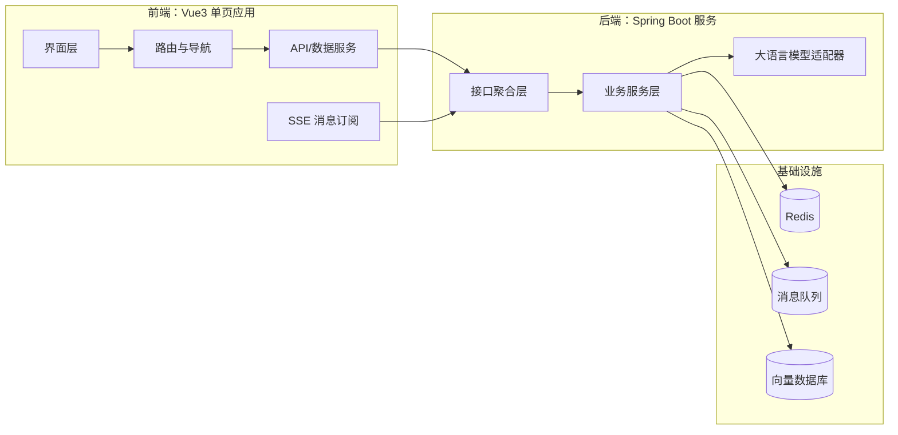

# AI智能体应用平台前端

这是一个基于Vue3开发的AI智能体应用平台，包含两个核心应用：ai代码大师和AI超级智能体。

## 项目架构



该架构突出前端通过SSE与后端实时通信，后端将业务逻辑与大模型能力解耦，并依赖多种基础设施提供缓存、异步任务和知识库检索等能力。

## 系统功能模块

- **用户交互中心**：统一的会话界面，提供模型选择、聊天记录展示、提示词管理等功能。
- **ai代码大师**：围绕编码开发场景提供代码生成、调试建议与最佳实践提示，并支持会话历史记忆。
- **AI超级智能体**：聚焦通用智能体能力，支持多场景问答、任务规划、工具调用以及智能体插件扩展。
- **内容安全与审核**：对话请求前后进行敏感词检测、风险提示和合规性过滤，保障对话安全可控。
- **运营与监控**：对接埋点及可观测系统，提供使用统计、问题反馈与系统健康度监控。

## 功能特点

- 💬 **ai代码大师**：智能编程顾问，为开发者提供代码实现建议和问题解答
- 🤖 **AI超级智能体**：全能型AI助手，解决各类专业问题

## 技术选型

### 前端

- Vue3 + Vite 构建现代化单页应用
- Vue Router 负责多页面路由与导航
- Axios 封装 REST 请求，SSE 用于实时流式响应
- @vueuse/head 等组合式生态工具提升开发效率

### 后端

- Spring Boot 提供 REST/SSE 服务能力
- OpenAI/自研大模型 SDK 作为 LLM 调用层
- Redis 用于会话缓存与限流控制
- 向量数据库支撑知识检索与上下文扩展

### 部署与运维

- Docker 镜像化前后端服务
- Nginx 负责静态资源托管与反向代理
- GitHub Actions/企业 CI 进行持续集成与自动化测试

## 开发说明

### 环境要求

- Node.js >= 16.0.0
- npm >= 7.0.0

### 安装依赖

```bash
npm install
```

### 启动开发服务器

```bash
npm run dev
```

### 构建项目

```bash
npm run build
```

## 后端接口

项目依赖以下后端接口：

- `/api/ai/fufu_app/chat/sse` - ai代码大师聊天接口
- `/api/ai/manus/chat` - AI超级智能体聊天接口

后端服务默认运行在 `http://localhost:8123`

# Vue 3 + Vite

This template should help get you started developing with Vue 3 in Vite. The template uses Vue 3 `<script setup>` SFCs, check out the [script setup docs](https://v3.vuejs.org/api/sfc-script-setup.html#sfc-script-setup) to learn more.

Learn more about IDE Support for Vue in the [Vue Docs Scaling up Guide](https://vuejs.org/guide/scaling-up/tooling.html#ide-support).
